**# Windows OS and Performance Troubleshooting**

**## Overview**

This project demonstrates hands-on Windows troubleshooting skills using built-in Windows tools in a virtual lab environment.

**## Objectives**

&#x20; - Practice investigating system performance

&#x20; - Check Windows health

&#x20; - Review startup application

&#x20; - Use diagnostic tools to identify and resolve common Windows issues

**## Environment**

&#x20; - Oracle VirtualBox

&#x20; - Windows client VM

&#x20; - Task manager, Resource monitor, Windows settings, Reliability Monitor, Command Prompt, System File Checker (sfc /scannow)

**## Task Performed**

**### 1. System information**

Reviewed Windows system information, including the operating system and hardware details.

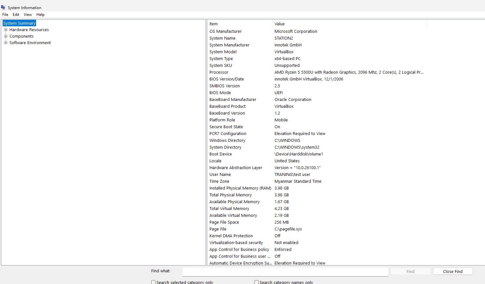

**### 2. Task Manager**

Reviewed running processes and their resource usage to understand how applications use system resources.

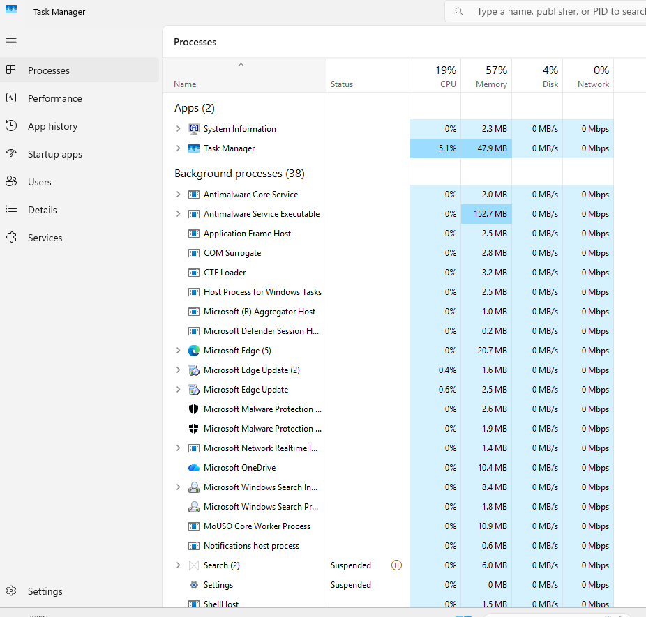

**### 3A. Task Manager - CPU Performance**

Monitored CPU utilization and reviewed the performance graph to understand processor usage.

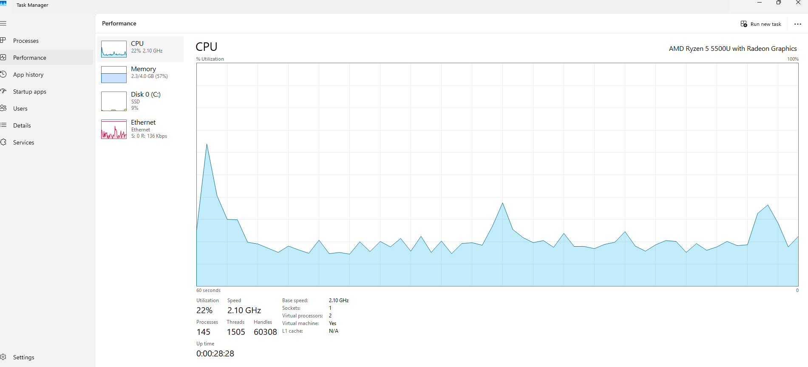

**### 3B. Task Manager - Memory Performance**

Reviewed memory utilization to understand how much RAM was in use and how Windows reports memory performance.

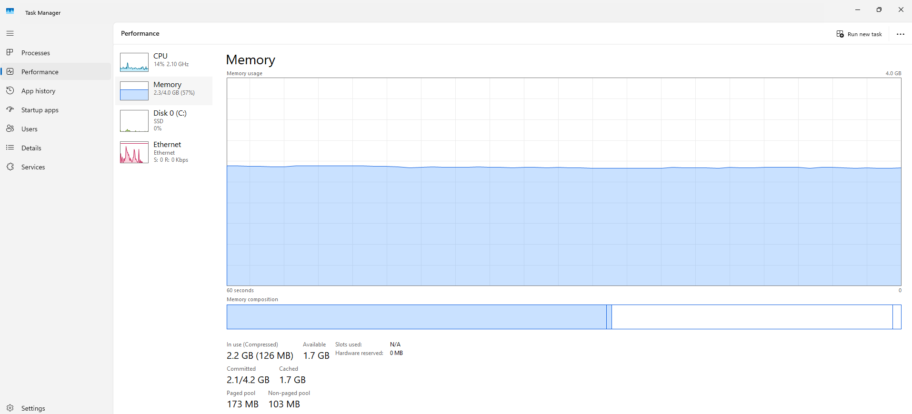

**### 4. Resource Monitor - Resource Usage**

Used Resource Monitor to examine system resource activity in more detail.

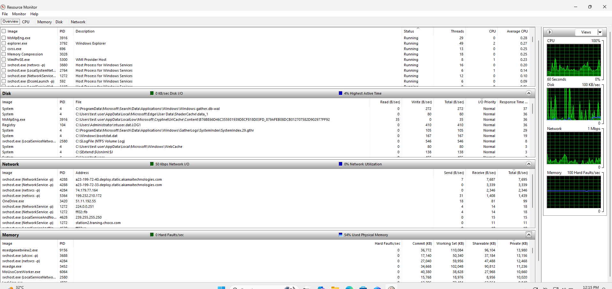

**### 5. Available Disk Space**

Checked available disk space to identify whether insufficient storage could contribute to Windows performance problems.

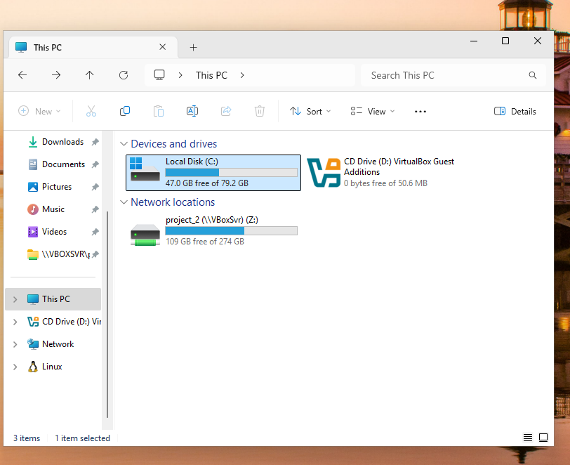

**### 6. High Resource Usage Investigation**

Investigated running processes and reviewed CPU and memory usage to practice identifying applications that may contribute to slow performance.

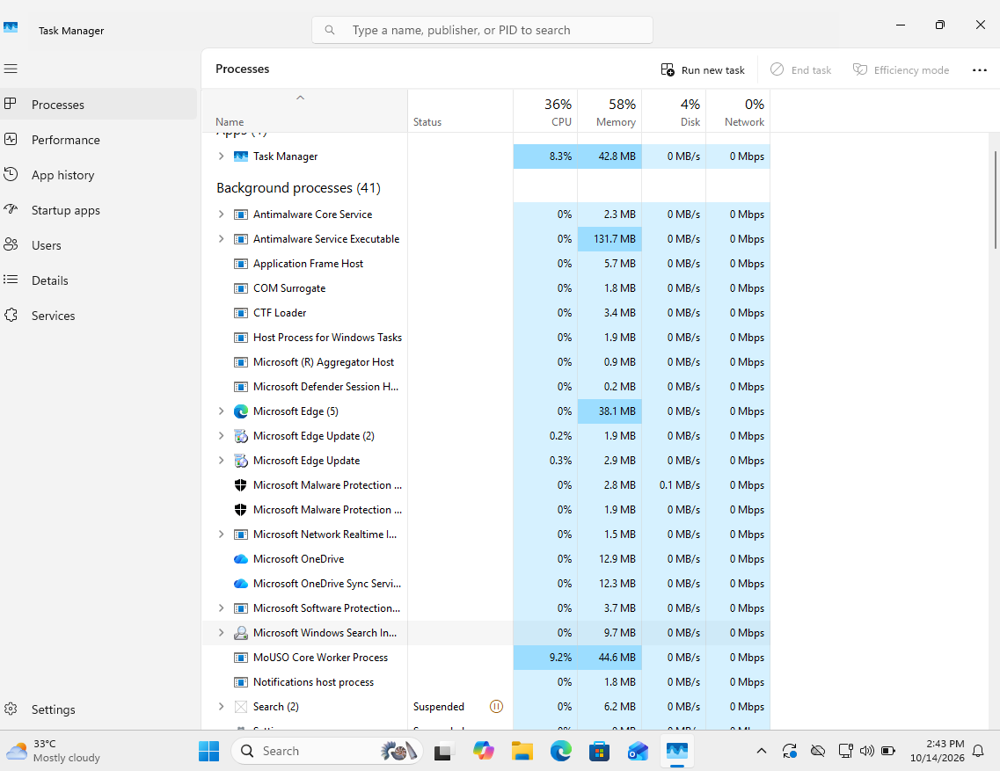

**### 7. Startup Application**

Reviewed applications configured to launch automatically when windows start.

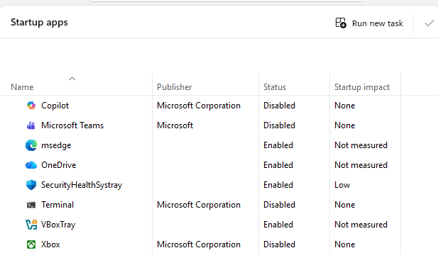

**### 8. Disable a Nonessential Startup Application**

Disabled a selected nonessential startup application to practice managing applications that launch automatically.

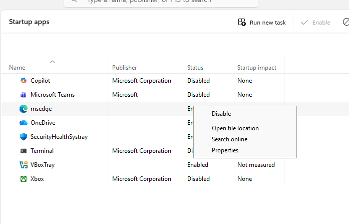

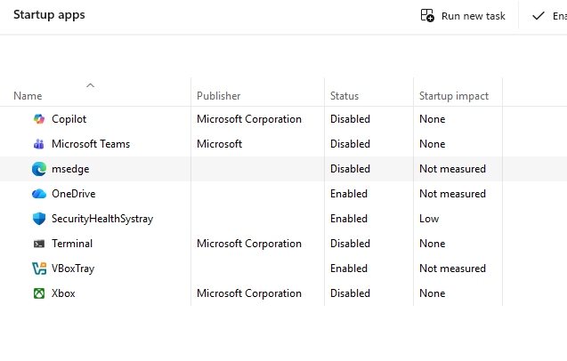

**### 9. Windows Update Status**

Checked the Windows update page to review the system's update status.

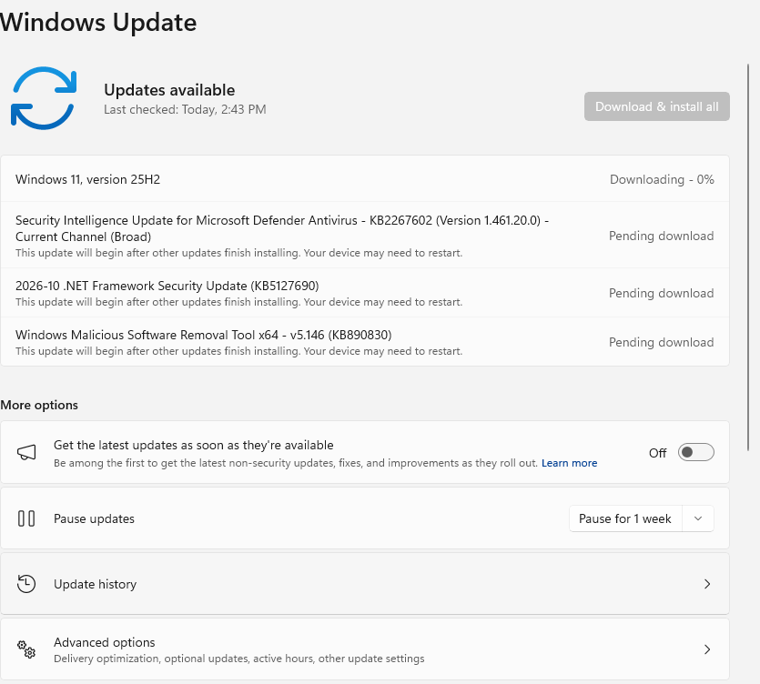

**### 10. Reliability Monitor**

Reviewed Windows reliability history to check for recorded application failures and system issues.

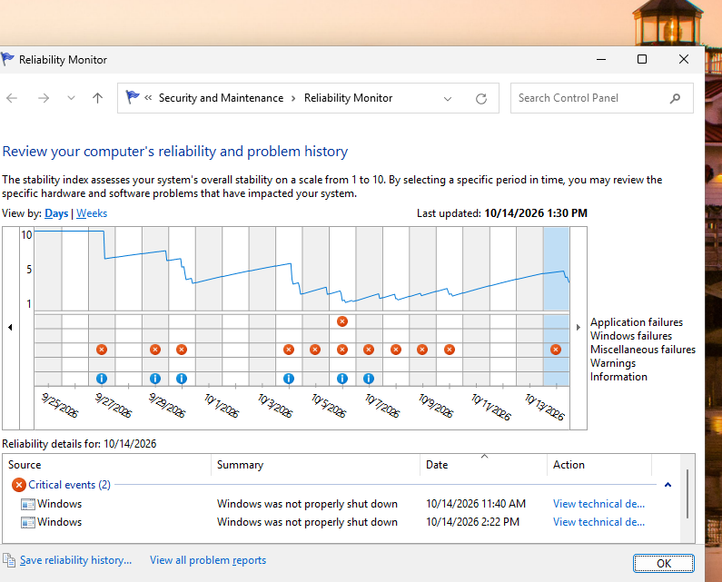

**### 11. System File Checker (SFC)**

Ran 'sfc /scannow' in an elevated Command Prompt to scan Windows system files for corruption. Windows reported that it found corrupt files and successfully repaired them.

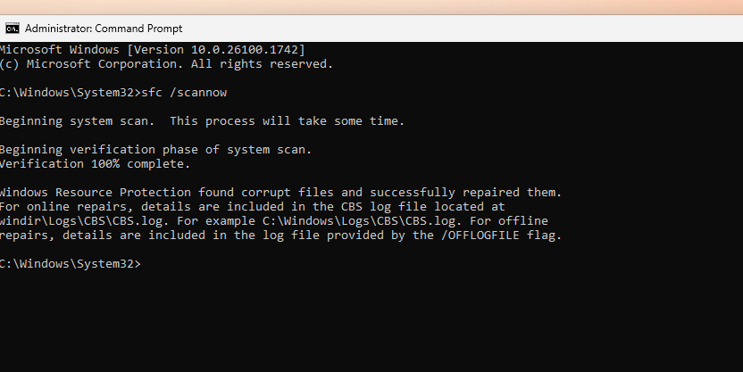

