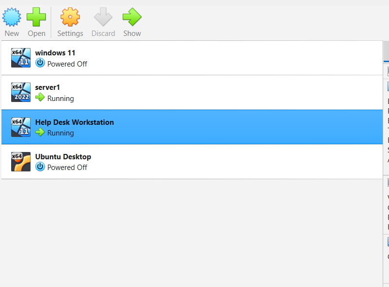
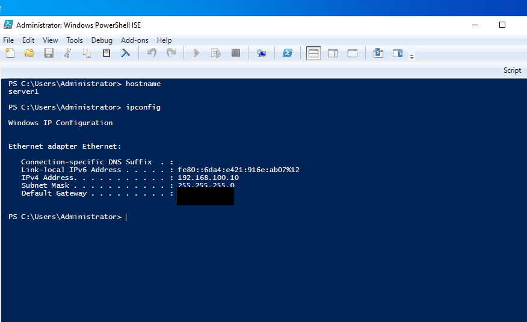
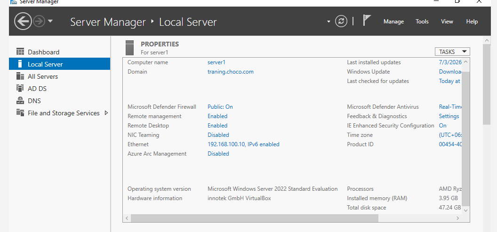
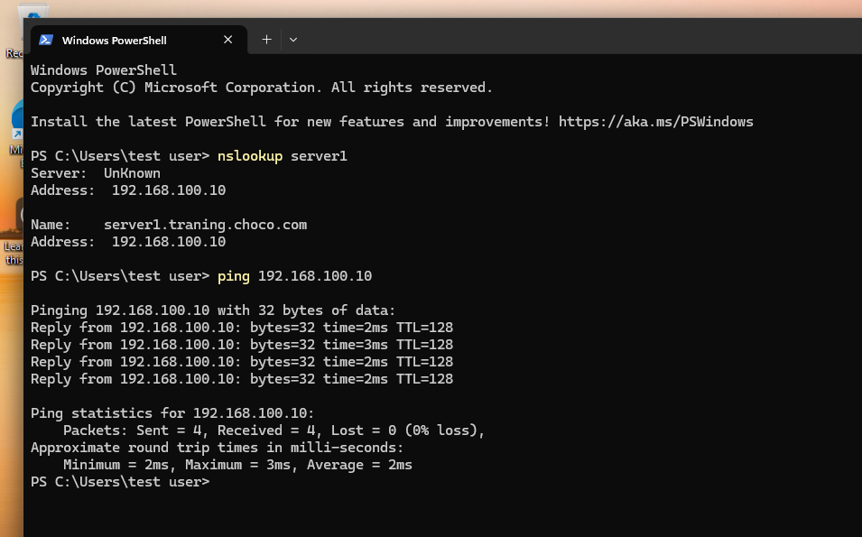
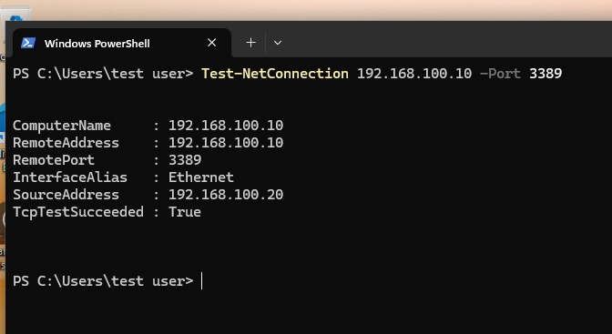
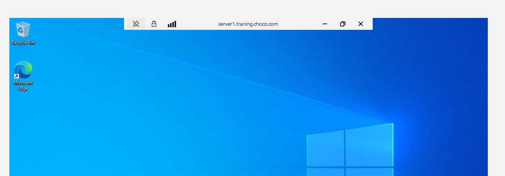
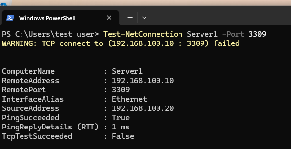
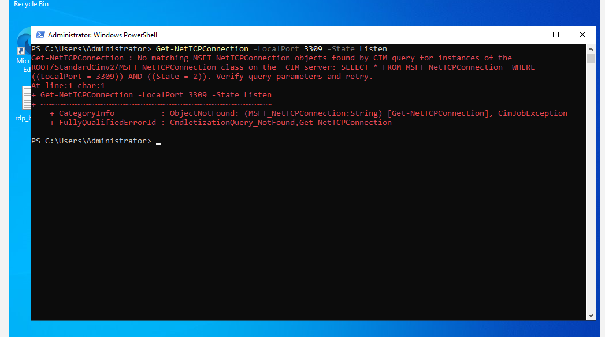

**# Remote Desktop (RDP) Connectivity Troubleshooting**

**## Overview**

This project demonstrates basic Remote Desktop Protocol (RDP) connectivity testing and troubleshooting in a virtual Windows environment. The lab focuses on identifying the server, checking Remote Desktop configuration, testing network connectivity, and investigating TCP port accessibility using built-in Windows tools.

**## Objectives**

&#x20;- Identify the Windows Server hostname and IPv4 address

&#x20;- Verify whether Remote Desktop is enabled

&#x20;- Test network connectivity between a Windows client and server

&#x20;- Test TCP connectivity to the default RDP port, 3389

&#x20;- Check the RDP listener and relevant Windows firewall settings

&#x20;- Use PowerShell to investigate TCP connectivity and listening ports

&#x20;- Establish and verify a successful Remote Desktop session

&#x20;- Practice a structured troubleshooting approach 

**## Environment**

&#x20;- Oracle VirtualBox

&#x20;- Windows Server virtual machine

&#x20;- Windows client virtual machine

&#x20;- Server Manager

&#x20;- Windows PowerShell

&#x20;- Windows defender Firewall with Advanced Security

&#x20;- Remote Desktop connection (mstsc.exe)

**## Tasks Performed**

**### 1. Lab Environment**

Reviewed the Windows Server and Windows client virtual machines used for the RDP connectivity lab.

**### 2. Server Hostname and IP Address**

Used the 'hostname 'and 'ipconfig' commands to identify the server's hostname and IPv4 address. This information was used to identify the remote computer and verify the destination for connectivity tests.

**### 3. Remote Desktop Status**

Checked the remote desktop setting in server manager local server and verified the remote desktop was enabled on the Windows Server.

**### 4. Client to Server Ping Test**

Used the 'ping' command form the Windows client to test network reachability to the server. The successful ping indicated that the server respond to ICMP requests.

**### 5. RDP Port 3389 Connectivity Test**

Used PowerShell 'Test-NetConnection' cmdlet to test TCP connectivity to port 3389, the default RDP port. The result 'True' verified that the client could establish a TCP connection to port 3389.

**### 6. Successful RDP Connection**

Used the built-in Remote Desktop Connection tool ('mstsc.exe') to connect from the Windows client to the Windows Server. Successfully accessed the remoter desktop using authorized credentials.

**### 7. Simulated TCP Connection**

Used 'Test-NetConnection' to test TCP connectivity to port 3309 on the server. The test returned  'PingSucceeded:True' and 'TcpTestSucceeded':False, demonstrating that a server can respond to ping even when a particular TCP port is unreachable.

Port 3309 was used as a test port; it is not the default RDP port.

**### 8. Check the Test-Port Listener**

Used PowerShell's 'Get-NetTCPConnection' cmdlet to investigate whether a TCP listener was present on the test port. This demoatrated how PowerShell can help investigate listening ports during connectivityi troubleshooting.

