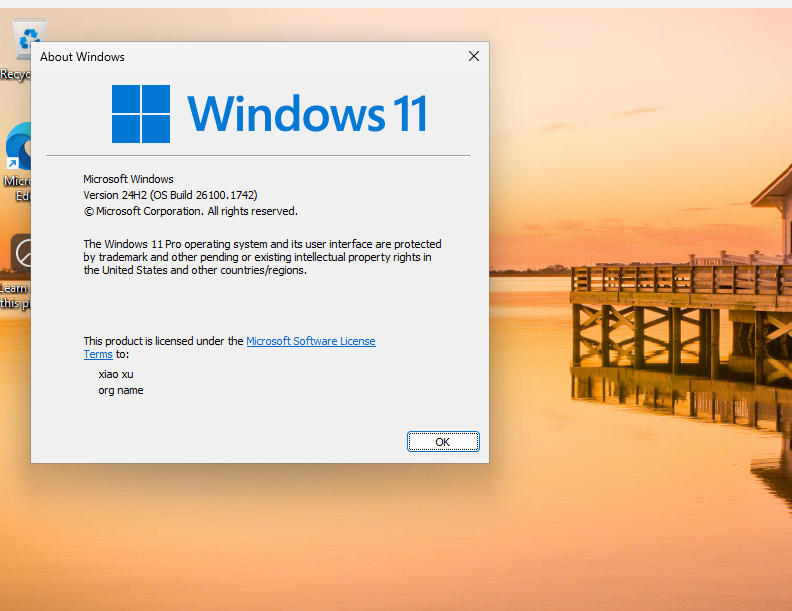
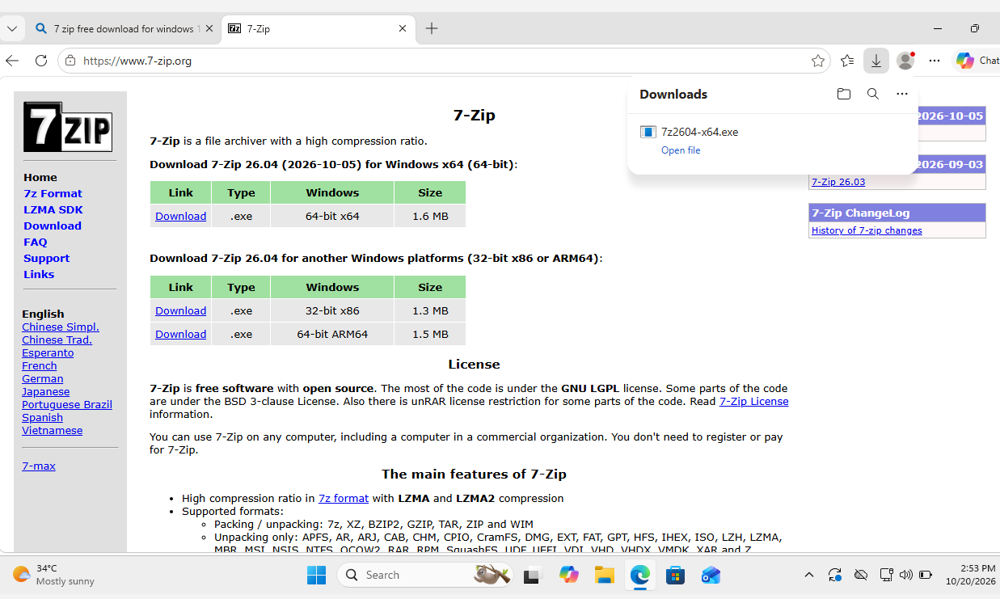
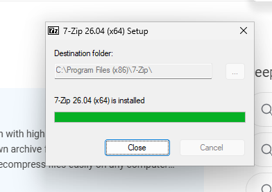
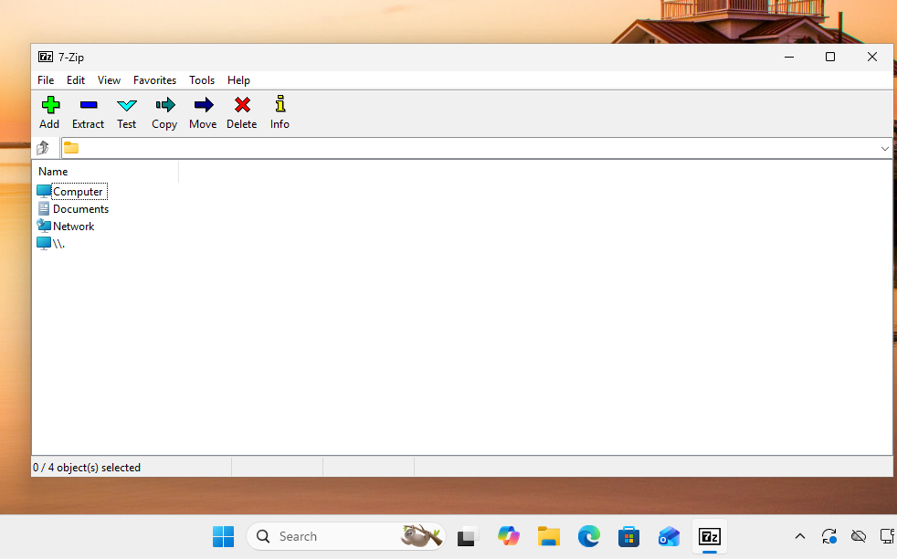
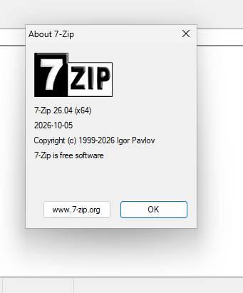
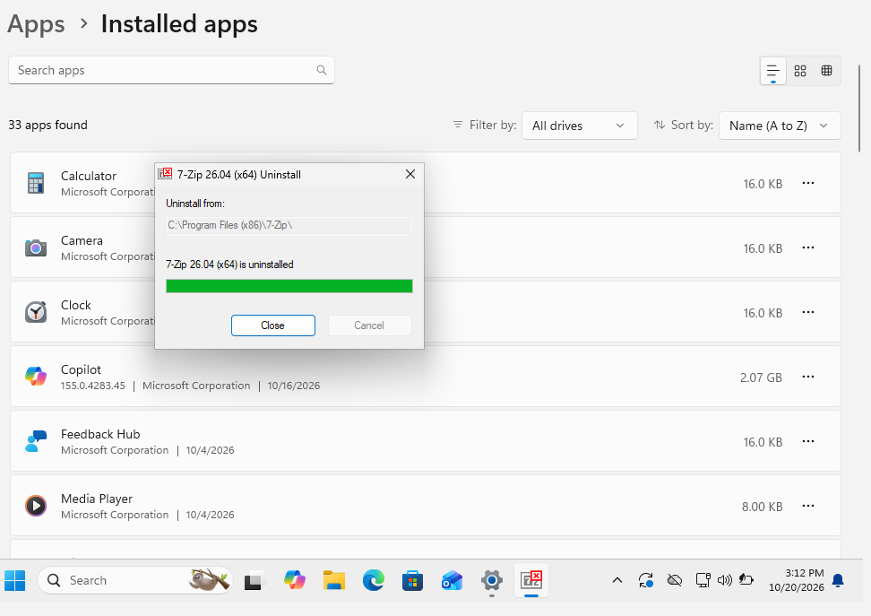
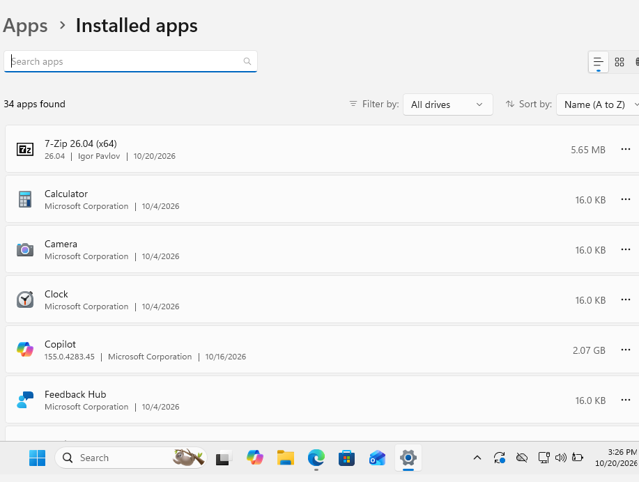
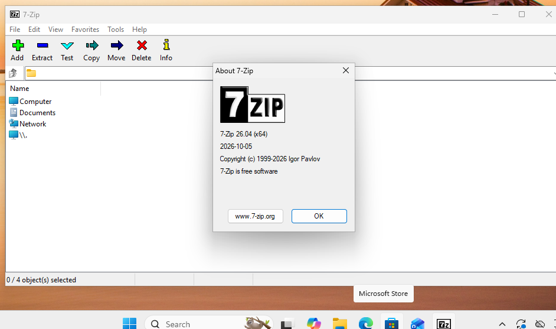

**# Windows Software Installation and Troubleshooting**

**## Overview**

This project demonstrates basic Windows software management tasks. Using a Windows client virtual machine, I downloaded and installed 7-zip from its official website, verified that the application launched successfully, checked its installed version, uninstalled, and reinstalled it.

**## Objectives**

&#x20; - Identify the Windows client environment and installed applications

&#x20; - Download software from its official website

&#x20; - Install an application on Windows

&#x20; - Verify successful application launch

&#x20; - Check the installed application version

&#x20; - Uninstall an application

&#x20; - Reinstall the application and verify that it works

**## Environment**

&#x20; - Oracle VirtualBox

&#x20; - Windows client VM

&#x20; - 7-Zip

&#x20; - Official 7-Zip Website ( https://www.7-zip.ort/ )

**## Tasks Performed**

**### 1. Verify the Windows Client Environment**

Checked the Windows version and OS build using the 'winver' command.

**### 2. Review Installed Applications**

Opened Windows setting and reviewed the installed applications list to identify software available on the client machine.

**### 3. Download the Official Application Installer**

Accessed the official 7-Zip website and selected the appropriate Windows installer for the client system.

**### 4. Install 7-Zip**

Ran the downloaded installer and followed the setup wizard to install 7-Zip on the Windows client.

**### 5. Verify Application Launch**

Opened 7-Zip File Manager after installation and confirmed that the application launched successfully.

**### 6. Verify the Installed Version**

Opened the About 7-Zip window to check the installed application version.

**### 7. Uninstall the Application**

Used Windows setting to uninstall 7-Zip, practicing a standard application removal procedure.

\### 8. Reinstall and Verify the Application

Reinstalled 7-Zip and opened the application again to confirm that it launched successfully after reinstallation.

